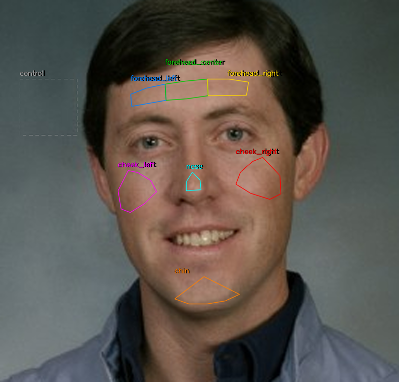

# PulseCheck

Detecting deepfakes by checking for a real heartbeat in facial video.

Every heartbeat changes skin colour by a tiny amount that a camera can pick up (remote
photoplethysmography, "rPPG"). In a real video all the skin patches on a face share one heart. In a
fake, the pulse may be missing, noisy, or inconsistent between patches. PulseCheck rebuilds this
idea from first principles, tests it honestly, and checks how well it holds up against modern AI
video. Design and plan: [docs/plan.md](docs/plan.md).

## Status

**Phase 2 of 9: the heart-rate engine is built and tested on synthetic signals; the detector comes
next.** The engine reads a heart rate from a face video or a live webcam. Its accuracy on real
recordings has **not yet been measured**: UBFC-rPPG is not downloaded and no own clips are
recorded, so the results table is still "pending" ([docs/results/hr_eval.md](docs/results/hr_eval.md)).
No deepfake detection exists yet.

## How it works

1. **Track the face:** MediaPipe Face Landmarker gives 478 landmarks per frame.
2. **Cut out skin regions:** seven skin patches (forehead x3, cheeks x2, nose, chin) plus one
   background "control" patch, each an outline of landmark points. The control sits to the
   image-left of the face unless less than 90% of it would be in frame.
3. **Average the colour** of every region in every frame. Tracking is the slow step, so the
   evaluation script caches these colour traces on disk; the `pulsecheck` commands re-extract on
   every run.
4. **Combine and resample:** the whole-face signal averages the skin regions after dividing each
   by its own mean colour (so a region dropping in and out does not cause jumps), and every signal
   is resampled to an even 30 Hz grid using the real frame timestamps.
5. **Turn colour into a pulse** with GREEN, CHROM or POS (POS is the default).
6. **Band-pass** 0.7-3.3 Hz (42-198 bpm; CHROM filters inside the method, so it is not filtered
   twice), then read the strongest spectral peak in 8 s windows as the heart rate, together with a
   signal-to-noise ratio. A whole-clip heart rate is also given, unless more than 20% of the clip
   had no usable face.

The method, formulas and reasons for each choice are in [docs/METHOD.md](docs/METHOD.md). A Q&A on
every design decision is in [docs/INTERVIEW_NOTES.md](docs/INTERVIEW_NOTES.md).



## Quickstart (Windows, PowerShell)

Python 3.12 or newer is needed (developed on 3.13). The virtual environment and all data live
**outside** the project folder, because the folder is synced by OneDrive.

```powershell
git clone https://github.com/JaskaranVaid/pulsecheck.git
cd pulsecheck
py -3.13 -m venv C:\dev\venvs\pulsecheck
C:\dev\venvs\pulsecheck\Scripts\python -m pip install -e ".[dev]"

$env:PULSECHECK_DATA = "C:\dev\pulsecheck-data"   # models, caches, recordings, datasets
```

`PULSECHECK_DATA` defaults to `~/pulsecheck-data` when unset. Set it permanently with
`setx PULSECHECK_DATA "C:\dev\pulsecheck-data"` (it applies to newly opened shells only). The
first run that needs face tracking downloads the Face Landmarker model (about 4 MB) into
`PULSECHECK_DATA\models`.

All commands below assume the `pulsecheck` executable from the venv, for example
`C:\dev\venvs\pulsecheck\Scripts\pulsecheck`, or activate the venv first with
`C:\dev\venvs\pulsecheck\Scripts\Activate.ps1`. MediaPipe prints a few harmless log lines to the
console on startup.

## Commands

| Command | What it does |
|---|---|
| `pulsecheck live [--camera 0] [--method pos]` | Webcam window with the regions outlined, a live pulse waveform and BPM. `q` or Esc quits. |
| `pulsecheck hr VIDEO [--method pos\|green\|chrom\|all] [--max-seconds 15]` | Heart rate and SNR per region and for the whole face. |
| `pulsecheck debug-video VIDEO --out OUT.avi` | Writes the video with the regions drawn on it, to check the tracking. |
| `pulsecheck extract VIDEO [--out traces.npz]` | Saves the per-region colour traces (the slow step) to an `.npz` file for inspection or later batch use; the default name is `<video folder>_<video name>.npz` under `PULSECHECK_DATA\traces`. |
| `pulsecheck record [--seconds 60] [--out clip.avi]` | Records a webcam clip, then asks for the pulse you counted by hand and logs it to `clips.csv`. |

Examples:

```powershell
pulsecheck live
pulsecheck hr C:\dev\pulsecheck-data\own\clip.avi --method all
pulsecheck debug-video C:\dev\pulsecheck-data\own\clip.avi --out C:\dev\pulsecheck-data\debug.avi
pulsecheck record --seconds 60          # count your pulse at the wrist while it records
```

Evaluate against UBFC-rPPG and your own clips (writes a CSV and
`docs/results/hr_eval.md`; needs the dataset downloaded first, see below). UBFC is reported two
ways: pooled over 8 s windows, and per video (one whole-clip heart rate per subject, the protocol
most published results use). The script caches each video's colour traces under
`PULSECHECK_DATA\cache`, so later runs skip the face tracking:

```powershell
C:\dev\venvs\pulsecheck\Scripts\python scripts/eval_hr.py `
    --ubfc-root C:\dev\pulsecheck-data\ubfc\DATASET_2 `
    --own-clips C:\dev\pulsecheck-data\own\clips.csv --max-seconds 60
```

Regenerate the figures in `docs/figures/`: `python scripts/make_figures.py`.

## Tests

```powershell
C:\dev\venvs\pulsecheck\Scripts\python -m pytest -q
C:\dev\venvs\pulsecheck\Scripts\python -m ruff check .
```

The tests use synthetic signals with a known heart rate and one public-domain portrait. They need
no webcam and no dataset. One test file (`test_face.py`) runs the real face tracker and so needs the
model download on first run.

## Data and licences

- **UBFC-rPPG** (pulse-oximeter ground truth) and the deepfake datasets planned for later stages are
  licensed for research and education only. Their videos are **never** committed to this repository
  and live under `PULSECHECK_DATA`. Request access from each dataset's authors.
- **Your own recordings** also stay out of git (`.gitignore` blocks `.avi`, `.mp4` and `.npz`).
- The only face image in the repository is an official NASA portrait (public domain, US government
  work); its source is in [tests/fixtures/README.md](tests/fixtures/README.md).

## Project layout

```
src/pulsecheck/
  face.py          MediaPipe Face Landmarker wrapper and model download
  regions.py       skin regions, control region, per-region mean colour
  extract.py       video -> per-region colour traces, plus the versioned cache eval_hr.py uses
  dsp.py           resampling, band-pass, spectrum, heart rate, SNR
  rppg.py          GREEN, CHROM and POS methods
  pipeline.py      traces -> per-region and whole-face heart rate
  evaluation.py    error metrics and ground-truth heart-rate series
  datasets/ubfc.py UBFC-rPPG loader
  live.py          webcam monitor and clip recorder
  viz.py           region overlay drawing
  cli.py           the `pulsecheck` command
  config.py        settings and data folders
scripts/           eval_hr.py, make_figures.py, make_landmark_fixture.py
tests/             unit tests, synthetic-signal helpers, public-domain fixture
docs/              plan.md, METHOD.md, INTERVIEW_NOTES.md, figures/, results/
```

## Roadmap

From [docs/plan.md](docs/plan.md), section 8. Phases 0-2 are done apart from the real-data checks
above.

- **Phase 2 (remaining):** run the UBFC evaluation and a few own-clip comparisons.
- **Phase 3:** dataset loaders and batch extraction (FaceForensics++, Celeb-DF, DF26), with splits
  that cannot leak between train and test.
- **Phase 4:** baseline "is there a pulse?" detector (the classic approach).
- **Phase 5:** consistency features: do the regions agree in timing and strength?
- **Phase 6:** test on modern AI video (DF26) and document where it fails.
- **Phase 7:** calibrated verdict: likely real / likely AI / can't tell.
- **Phase 8:** Streamlit demo app.
- **Phase 9:** presentation: results tables, limitations, CI.
- **Phase 10 (stretch):** small CNN comparison.

## License

MIT. See [LICENSE](LICENSE).
