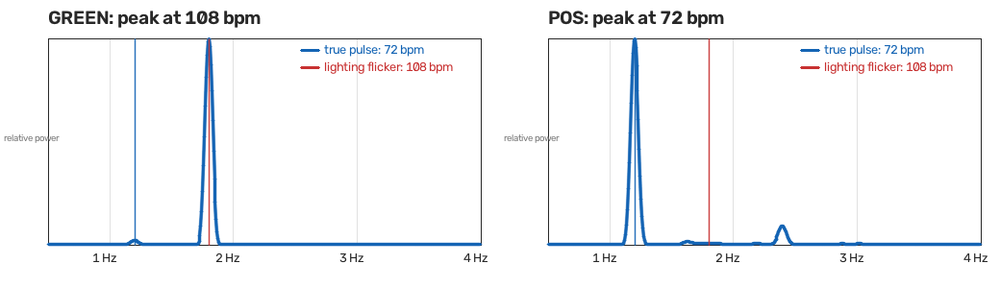

# Method: the rPPG heart-rate engine

This document explains how PulseCheck turns a face video into a heart rate, and why each step is
built the way it is. It covers the first build stage only (the heart-rate engine). The detector
that decides real vs. fake comes later and is described in [plan.md](plan.md).

Contents: [1 Why skin colour pulses](#1-why-skin-colour-pulses) ·
[2 Pipeline](#2-pipeline) · [3 Regions](#3-regions) · [4 From colour to pulse](#4-from-colour-to-pulse-green-chrom-pos) ·
[5 Resampling](#5-resampling-to-a-uniform-30-hz-grid) · [6 Filter, spectrum, heart rate](#6-band-pass-spectrum-and-heart-rate) ·
[7 SNR](#7-signal-to-noise-ratio-snr) · [8 Windows and validity](#8-windows-and-validity) ·
[9 Evaluation](#9-evaluation) · [10 Results](#10-results) · [11 Limitations](#11-known-limitations)

## 1. Why skin colour pulses

Every heartbeat pushes a small pulse of blood through the vessels just under the skin. Blood
absorbs light, and it absorbs green light much more than red. So when more blood is under the skin,
the skin reflects a tiny bit less green light, and the face gets very slightly darker and
redder, then recovers before the next beat. The change is a fraction of a percent of the pixel
brightness, far too small to see, but a camera records it and averaging over many pixels makes it
measurable. This is **remote photoplethysmography (rPPG)**: "photoplethysmography" is measuring
blood volume with light (the green LED on a smartwatch does it), and "remote" means doing it with an
ordinary camera from a distance.

Everything else in the pipeline exists to dig this tiny periodic signal out of noise: camera
sensor noise, head motion, and changes in room lighting.

## 2. Pipeline

```
video frame
  -> face landmarks            MediaPipe Face Landmarker, 478 points            (face.py)
  -> 7 skin regions + control  convex hulls of landmark subsets                 (regions.py)
  -> mean R, G, B per region   one row per frame, NaN if region unusable        (extract.py)
  -> [eval only] cache .npz    keyed by traces version, path, size, mtime, cap  (extract.py)
  -> resample to 30 Hz         on video timestamps, gaps over 0.5 s flagged     (dsp.py)
  -> GREEN / CHROM / POS       colour -> one pulse signal                       (rppg.py)
  -> band-pass 0.7-3.3 Hz      Butterworth, order 3, zero-phase (CHROM: once,   (dsp.py)
                               inside the method)
  -> spectrum, peak, SNR       8 s windows, 1 s step                            (dsp.py)
  -> heart rate per region and for the whole face                               (pipeline.py)
```

Face tracking is the slow step (about 20 frames/second on a 640x800 video on the development
laptop, an i5-1335U with no GPU). The evaluation script (`scripts/eval_hr.py`) therefore caches
each video's colour traces (`extract.cached_traces`), so re-running it with another rPPG method,
filter or window does not re-run the tracker. The cache key includes `TRACES_VERSION`, a number
that is raised whenever extraction changes what a trace contains; every file stores it too, and a
file with a missing or different version is treated as a cache miss and recomputed. The
`pulsecheck` command line does **not** use this cache: `pulsecheck hr` re-extracts on every run,
and `pulsecheck extract` only saves a video's traces to an `.npz` file for inspection or later
batch use.

## 3. Regions


*The regions drawn on the public-domain NASA portrait in `tests/fixtures` (see
`tests/fixtures/README.md` for its source and licence). Regenerate with
`python scripts/make_figures.py`. "Left" and "right" are as seen in the image, not the subject's
own left and right.*

- **Seven skin regions:** `forehead_left`, `forehead_center`, `forehead_right`, `cheek_left`,
  `cheek_right`, `nose`, `chin`. Each is the convex hull (the tightest convex outline) of a small
  set of landmark points, so it is a plain polygon that moves with the face. Eyes, eyebrows and
  lips are deliberately left out: they move and cast shadows on their own, which would swamp the
  pulse. `regions.py` lists forbidden landmarks for these and tests check, on the test portrait, that no skin region
  contains any of them.
- **One control region:** a patch of background beside the head at forehead height. There is no
  skin there, so a real pulse should not appear in it. If a "pulse" does show up in the control
  region, it came from the lighting or the camera, not from the heart. The patch is
  0.15-0.45 face widths to the image-left of the face, as long as at least 90% of it is inside the
  frame; otherwise it goes on whichever side has the larger share inside the frame (ties go
  left). The rule compares *shares*, not pixel areas, on purpose: an earlier version picked the
  side with more pixels, and when both patches were whole their areas differed only by rounding,
  so sub-pixel tracker jitter kept flipping the side (on the test portrait, 200 frames with
  uniform +/-0.3 px landmark jitter flipped it 65 times; the current rule never flips, and a test
  checks that). The two sides differ in colour, so the control trace became a square wave far
  larger than any pulse.
- **Clipping and unusable regions:** polygons are clipped to the image with
  `cv2.intersectConvexConvex`, so a face half out of frame gives a smaller region instead of an
  error. A region with fewer than 20 pixels returns NaN (not a number) for that frame, which later
  steps treat as "no data".
- **The `face` signal:** the combined colour of whichever skin regions have data in each frame. It
  is less noisy than any single region, and it is the number the heart-rate evaluation uses.
  Each region's R, G and B are first divided by that region's own average over the clip, so every
  region sits around 1.0; the per-frame mean of these is then multiplied by the average of the
  region averages to keep an RGB-like level (`pipeline.face_signal`, also used by the live view).
  Without the normalisation, a bright region (say a cheek) that is missing in some frames would
  pull the plain average up and down by a few percent each time it drops in or out, many times
  the pulse. A synthetic test (regions between 15% darker and 20% brighter than each other, the
  brightest cheek missing on a random 10% of frames) checks that GREEN's 8 s windows still read
  72 bpm with a mean error of at most 0.5 bpm.

## 4. From colour to pulse: GREEN, CHROM, POS

All three take a trace of mean `(R, G, B)` per frame, sampled uniformly, and return one pulse
signal. Write `Rn`, `Gn`, `Bn` for a channel divided by its own average, so each sits around 1.0
and only the relative changes remain.

**GREEN** (the baseline). Use the green channel alone: `g / mean(g) - 1`. Green carries the
strongest pulse (see section 1), so this works in a steady room. Its weakness is that any change
in overall brightness (a flickering lamp, a passing shadow, auto-exposure) moves green just as much
as the pulse does, and GREEN cannot tell them apart.

**CHROM** (de Haan & Jeanne, 2013). Skin colour changes from the pulse and from brightness have
different *directions* in colour space: brightness scales R, G and B together, while blood changes
them by different amounts. CHROM builds two combinations of the normalised channels:

```
X = 3 Rn - 2 Gn
Y = 1.5 Rn + Gn - 1.5 Bn
```

band-passes both, and subtracts one from the other with a weight chosen so that whatever X and Y
have in common (the brightness change) cancels:

```
alpha = std(X_filtered) / std(Y_filtered)
pulse = X_filtered - alpha * Y_filtered
```

This is the "global" version: one `alpha` for the whole clip. Because CHROM's own definition
band-passes X and Y before computing `alpha`, its output is already band-limited, and the
pipeline does not band-pass it a second time (GREEN and POS are band-passed once, after the
method).

**POS** (Wang et al., 2017, "plane orthogonal to skin"). POS also works on the normalised channels
but projects them onto two axes that are *exactly* perpendicular to the brightness direction
`(1, 1, 1)`:

```
S1 =        Gn - Bn          (axis  [ 0,  1, -1])
S2 = -2 Rn + Gn + Bn         (axis  [-2,  1,  1])
h  = S1 + (std(S1) / std(S2)) * S2
```

Because both axes have coefficients that sum to zero, a pure brightness change (the same
multiplier on R, G and B) contributes nothing to `S1` or `S2`. The weight `std(S1)/std(S2)`
combines the two projections so the pulse adds up while remaining noise is reduced. This is done on
a sliding **1.6 s window** (48 samples at 30 Hz): each window gives one `h` with its mean removed,
and the overlapping windows are added together. Short windows keep each projection roughly stable
even when the skin tone or lighting drifts.

**Why POS is the default.** A test in the repository (`tests/test_rppg.py`) builds a synthetic
72 bpm pulse and adds a lighting flicker at 108 bpm that is about five times stronger than the
pulse. GREEN reads 108 bpm, the flicker; CHROM and POS both read the true 72 bpm.



*Spectrum of the same synthetic signal after GREEN (left) and POS (right). Regenerate with
`python scripts/make_figures.py`. This is a synthetic demonstration of why the method choice
matters, not a measured result on real video.*

All three methods are implemented in `rppg.py`, each in a few lines of NumPy. The choice of default
is tested on real video by the evaluation in section 9; until those results exist, POS is the
default because of the published literature and the flicker behaviour above, not because it won on
our data.

## 5. Resampling to a uniform 30 Hz grid

Video frames do not arrive at perfectly even intervals, especially from a webcam, and datasets mix
24, 25 and 30 fps. The filter and the Fourier transform both assume evenly spaced samples, and
uneven spacing shows up as fake frequencies. So `dsp.resample_uniform` linearly interpolates the
per-frame colour onto an even 30 Hz grid *using each frame's real timestamp*.

- Frames with no data (face lost) are dropped before interpolating.
- Interpolation across a gap is allowed only up to **0.5 s**. Inside a longer gap the grid is still
  filled (the filter needs a continuous signal) but those samples are flagged `valid = False`.
- **One shared grid, anchored to the start of the video.** The pipeline builds a single time grid from the
  first to the last frame and passes it to every region (the `t_out` argument). Samples before the
  first or after the last valid frame are flagged invalid, not trimmed. Consequences: all regions
  line up sample for sample, and every window's centre time is "seconds from the start of the
  video", the same clock the ground-truth heart rate uses.

## 6. Band-pass, spectrum and heart rate

- **Band-pass 0.7-3.3 Hz** (42-198 beats per minute), Butterworth order 3, applied forwards and
  backwards (`sosfiltfilt`) so it adds no time shift. Below 0.7 Hz is slow drift and breathing-rate
  changes; above 3.3 Hz is beyond any plausible resting or exercising heart rate.
- **Detrending.** The plan's "detrend" step is done by the 0.7 Hz high-pass edge of this filter,
  plus the constant (mean) detrend that `scipy.signal.periodogram` applies to each window.
- **Spectrum:** a Hann-windowed periodogram (a squared Fourier transform with a smooth window to
  limit leakage), zero-padded to at least 4096 points. Zero-padding does not add real frequency
  resolution (that is set by the window length, `1/T` Hz) but it samples the spectrum finely enough
  that the peak position is not rounded to a coarse grid.
- **Heart rate** = the frequency of the strongest spectral peak inside 0.7-3.3 Hz, times 60.
- A flat or constant input returns NaN instead of a confident-looking number.

The project plan mentioned a Welch spectrum. A single windowed periodogram is used instead:
Welch splits an 8 s window into shorter segments and averages them, which costs frequency
resolution that 8 s cannot spare.

## 7. Signal-to-noise ratio (SNR)

The SNR says how much of the signal's power sits at the heart rate (and its harmonic) rather than
spread across everything else. It follows the style of de Haan & Jeanne (2013):

```
f0     = frequency of the spectral peak in 0.7-3.3 Hz
signal = power within  f0 +/- 0.1 Hz     plus power within  2*f0 +/- 0.2 Hz
noise  = all other power between 0.5 and 5 Hz
SNR    = 10 * log10(signal / noise)       in decibels (dB)
```

The second harmonic (`2*f0`) is counted as signal because a real pulse wave is not a pure sine; it
has a sharp rise and a slower fall, which puts energy at twice the heart rate. 0 dB means signal and
noise power are equal; higher is cleaner.

SNR is the main "is there a pulse?" quality number that the later detector will use as a feature.

## 8. Windows and validity

- **8 s windows with a 1 s step** for sliding-window heart rate. The window is a trade-off between
  frequency detail and following changes in heart rate. Its natural bin spacing is `1/T` Hz
  (0.125 Hz, 7.5 bpm, at 8 s). The position of a single peak can be located more finely than that
  (the zero-padding in section 6), but to show up as two *distinct* peaks, two tones need to be
  about `2/T` apart with a Hann window (0.25 Hz, about 15 bpm, at 8 s), because the Hann main lobe
  is `+/- 2/T` wide.
- A window is **invalid (NaN)** if more than 20% of its samples are flagged invalid (face lost, or
  inside a gap longer than 0.5 s). Validity is tracked per region, so a region the tracker could not
  see is dropped for those windows without discarding the whole frame for the other regions. Each
  region's result carries its own validity mask on the shared grid (`RegionResult.valid`; all
  False for an unusable region), and the face's mask is `Analysis.valid`.
- The **whole-clip heart rate** (`RegionResult.hr`, used for own clips and the per-video UBFC
  protocol) follows the same 20% rule over the whole grid (the same constant,
  `dsp.MAX_INVALID_FRACTION`): if more than 20% of a region's grid, or the face's, is invalid,
  its whole-clip result is NaN instead of a number computed mostly from interpolation.
- A clip shorter than **3 s** is rejected (`ValueError: clip too short`). A clip between 3 s and 8 s
  yields one window over the whole clip.
- A region that cannot be analysed at all (too few valid samples, or a non-positive mean colour)
  gives NaN results; it does not crash the analysis of the other regions.

## 9. Evaluation

Two checks, both run by `scripts/eval_hr.py`:

1. **UBFC-rPPG** (public dataset of faces filmed with a pulse oximeter). The ground truth is
   computed from the oximeter's PPG signal with the *same* resampling, band-pass and peak rule as
   the video, so any difference comes from the video and not from two different estimators.
   Metrics are MAE (mean absolute error, in bpm), RMSE (root mean squared error, which punishes
   large misses more) and Pearson r (do the two numbers move together). Two protocols are
   reported, each in its own table in `hr_eval.md`:
   - **Windowed (8 s / 1 s, pooled).** 8 s windows every 1 s on both sides
     (`evaluation.reference_series`), matched by centre time (which must agree within 0.5 s),
     with the metrics **pooled over every window of every subject**. This measures how well the
     estimate tracks the heart rate over time.
   - **Per-video (whole clip).** One pair per subject: the face's whole-clip heart rate
     (`face.hr`) against the whole-clip heart rate of the PPG over the same duration
     (`evaluation.reference_hr`: resampled, band-passed, `estimate_hr`). This is the protocol most
     published UBFC-rPPG results use, so it is the one to compare with the literature. A subject
     whose whole-clip estimate is NaN (section 8) has no pair here.

   If the methods in one table end up with different numbers of pairs (one failed on a subject the
   others handled), the table gets a warning line: the methods were compared on different subject
   sets, so their rows are not directly comparable.
2. **Own webcam clips.** `pulsecheck record` saves a clip and asks for the pulse counted by hand at
   the wrist. `eval_hr.py` compares the whole-clip heart rate with that count. A clip whose
   whole-clip estimate is NaN (face invalid for more than 20% of it) is reported as an error row
   ("no valid face signal") and not counted as evaluated. The reference is rough (a few bpm of
   error), so this is a sanity check on real-world footage, not a precise accuracy figure.

## 10. Results

No real-data results exist yet. UBFC-rPPG has not been downloaded and no own-clips have been
recorded. The table in [results/hr_eval.md](results/hr_eval.md) is generated by the command below;
nothing is entered by hand.

| Method | UBFC windowed MAE / RMSE / r | UBFC per-video MAE / RMSE / r | Own clips MAE (bpm) |
|---|---|---|---|
| GREEN | pending | pending | pending |
| CHROM | pending | pending | pending |
| POS | pending | pending | pending |

To fill it in (after downloading UBFC-rPPG into the data directory and recording clips with
`pulsecheck record`):

```powershell
$env:PULSECHECK_DATA = "C:\dev\pulsecheck-data"
C:\dev\venvs\pulsecheck\Scripts\python scripts/eval_hr.py `
    --ubfc-root C:\dev\pulsecheck-data\ubfc\DATASET_2 `
    --own-clips C:\dev\pulsecheck-data\own\clips.csv --max-seconds 60
```

The goal set in the plan is POS within about 5 bpm MAE on UBFC. That is a target, not a result.

## 11. Known limitations

- **SNR depends strongly on clip length.** With the definition in section 7, the same clean 72 bpm
  sine scores very different SNRs depending on how long it is. Measured on the development machine
  (a noise-free 1.2 Hz sine sampled at 30 Hz, band-passed with `dsp.bandpass`, read with
  `dsp.estimate_hr`):

  | Clip length | 20 s | 8 s | 5 s | 4 s |
  |---|---|---|---|---|
  | SNR of an identical clean 72 bpm sine | 32.9 dB | 6.7 dB | 1.6 dB | -0.0 dB |
  | Heart rate read from it | 72.1 bpm | 72.1 bpm | 72.1 bpm | 71.6 bpm |

  The reason is spectral leakage: a Hann window of length `T` spreads a pure tone over a main
  lobe about `+/- 2/T` Hz wide. At 20 s that is `+/- 0.1 Hz`, which fits inside the signal band; at
  8 s it is `+/- 0.25 Hz`, so much of the tone's own energy lands outside the `+/- 0.1 Hz` band and
  is counted as noise. The heart rate itself stays within half a beat per minute (the small
  offsets come from the 4096-point spectrum's 0.44 bpm spacing and, at 4 s, from the band-pass
  filter's edge effects on so short a clip); only the SNR number shifts.

  *Design consequence for the detector:* SNR is only comparable between clips of the **same
  length**. Real, fake and modern AI videos will not have the same length (the DF26 clips are
  about 4-6 s), so later stages must compute features on equal-length windows for every dataset, and
  must not compare raw SNR across datasets with different clip lengths.
- **Short clips give coarse heart rates.** The bin spacing is `1/T` (7.5 bpm at 8 s) and two
  tones need about `2/T` (about 15 bpm at 8 s) to appear as separate peaks; both get worse for
  shorter clips.
- **Accuracy on real video is not yet measured** (section 10).
- **Face tracking speed.** About 20 frames/second on this laptop, so large batches take hours.
- **Skin tone, motion and compression** all weaken the signal. These effects are not yet
  quantified.
- **Rolling shutter biases the phase lags (detector, group C).** Most cameras read the sensor row
  by row, so the chin is captured a few milliseconds after the forehead. A measured lag between
  regions at different heights (`c_lag_<region>` in `features.group_c`) is therefore partly row
  readout time, not blood flow. The offset is the same for every face filmed with that camera,
  so the real-face reference (`reference.RealFaceReference`, fitted on training reals) absorbs
  any camera-consistent offset; what stays informative is the deviation from the real pattern.
